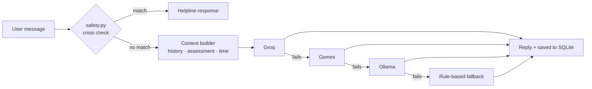

# MindMate — AI Mental Health Companion


A Flask web app that offers a supportive, sentiment-aware chat companion alongside self-care tools: mood check-ins, a self-assessment with a downloadable PDF report, guided breathing, calming music and a progress dashboard.

**Live demo:** https://mind-mate-yk1s.onrender.com
*(Free Render instance — the first load can take ~30 seconds to wake up.)*


> MindMate is a student project for emotional support and self-reflection. It is **not** a substitute for professional care or diagnosis. In India, call **Tele-MANAS 14416** or emergency **112** if you or someone else is in danger.

## Features

- **Multi-LLM chat with failover** — replies come from Groq (Llama 3.3 70B) first, then Gemini, then a local Ollama model, and finally a rule-based fallback, so the chat keeps working when a provider is down or rate-limited.
- **Safety first** — every message is screened for crisis language *before* it reaches any model. A match returns India helpline details (Tele-MANAS, 112, AASRA, Vandrevala, iCall) instead of an AI reply. The detector lives in one module ([`safety.py`](safety.py)) with unit tests and CI.
- **Context-aware responses** — the assistant uses recent chat history, the user's latest assessment and time of day (with extra care during late-night hours).
- **Self-assessment** — a questionnaire scores stress, anxiety and low mood, gives recommendations, and exports a PDF report.
- **Self-care tools** — emotion check-in, breathing exercises, music therapy and a light-hearted jokes page.
- **Dashboard** — 7-day usage and mood trends per user.
- **Accounts** — sign-up, login and password reset with hashed passwords.

## Architecture



## Tech stack

Python 3.12 · Flask · SQLite · Groq API · Google Gemini API · Ollama · ReportLab · HTML/CSS/JavaScript · Gunicorn · Render

## Run locally

```bash
git clone https://github.com/Anjali-Sinkar/Mind-Mate.git
cd Mind-Mate
python -m venv .venv && source .venv/bin/activate   # Windows: .venv\Scripts\activate
pip install -r requirements.txt
cp .env.example .env    # add GROQ_API_KEY and/or GEMINI_API_KEY
python app.py           # http://127.0.0.1:5000
```

At least one of Groq, Gemini or Ollama should be configured; without any, the rule-based fallback still answers.

## Tests

```bash
pip install pytest
pytest -q tests
```

## Deployment

See [DEPLOYMENT.md](DEPLOYMENT.md) for Render settings (a persistent disk keeps the SQLite database across restarts).

## Roadmap

- Hindi and Marathi support for crisis detection and replies
- An evaluation set to measure reply tone and safety across the three model providers
- Move from SQLite to PostgreSQL for multi-instance deployment

## Author

**Anjali Sinkar** — [Portfolio](https://anjali-portfolio-six-beige.vercel.app/) · [LinkedIn](https://www.linkedin.com/in/anjali-sinkar-97728925a) · [GitHub](https://github.com/Anjali-Sinkar)
